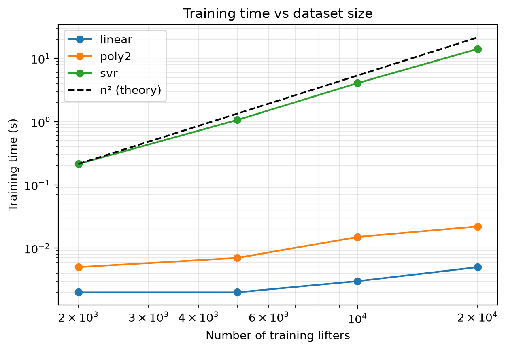

# Powerlifting potential: predicting squat and deadlift from bench press

Given a lifter's bench press and profile (bodyweight, age, sex, drug-tested category), predict the squat and the deadlift they can expect to reach in a raw powerlifting meet.

## Problem

A lifter who comes from bench press or street lifting and wants to start powerlifting has no idea what to aim for on the two lifts they have never trained. The usual gym rule is a fixed ratio ("your squat is about 1.5 times your bench"), the same for everybody, whatever their bodyweight, sex or age.

This project measures how wrong that rule is, and how much a machine learning model does better, on real competition results.

## Data

- **Source:** [OpenPowerlifting](https://www.openpowerlifting.org) competition results, through the [Kaggle "Powerlifting Database"](https://www.kaggle.com/datasets/open-powerlifting/powerlifting-database) (snapshot up to January 2024). The data is in the public domain.
- **Raw file:** 3,043,013 rows (one lifter in one meet), 41 columns.
- **Filtering** (`src/ml_powerlifting_potential/data.py`):

| Step | Rows left |
|---|---|
| Raw dataset | 3,043,013 |
| Full power meets (squat, bench, deadlift) | 2,107,555 |
| Raw equipment only | 771,491 |
| No disqualification, no doping disqualification | 742,425 |
| Bars of at least 20 kg, sex M or F, bodyweight of at least 40 kg | 737,465 |
| Known age, 16 or older | 602,825 |
| Meets since 2000 | 602,045 |
| **One row per lifter (best total)** | **227,625** |

Row-level filters run before keeping one row per lifter, so that a lifter whose best total comes from a youth meet falls back on their best adult meet instead of disappearing.

- **Inputs (5):** best bench press, bodyweight, age, sex (M = 1, F = 0), drug-tested category (Yes = 1, empty = 0).
- **Targets (2):** best squat, best deadlift, one model per target.
- **Excluded on purpose:** total, Wilks, Dots, Goodlift and placing are computed from the targets (data leakage); attempt columns; weight class (redundant with bodyweight).

## Approach

- Random 80 / 20 split with a fixed seed: 182,100 lifters for training, 45,525 for testing. With one row per lifter, no lifter appears on both sides.
- Scaling inside scikit-learn pipelines, so it is fitted on the training set only.
- Models compared:
  - **gym rule:** median per-lifter ratio on the training set (squat = 1.57 × bench, deadlift = 1.85 × bench);
  - **linear regression;**
  - **polynomial regression,** degrees 2 and 3;
  - **RBF support vector regression (SVR),** with standardized inputs and target.
- SVR hyperparameters tuned with `GridSearchCV` (3-fold cross-validation, two passes, on 8,000 lifters): `C = 30`, `gamma = 0.02`, `epsilon = 0.1`, identical for both targets.
- The test set is used once, for the final comparison. Metric: mean absolute error (MAE) in kg, plus R².

## Results

Test set, 45,525 lifters:

| Model | Squat MAE | Squat R² | Deadlift MAE | Deadlift R² |
|---|---|---|---|---|
| Gym rule | 21.6 kg | 0.748 | 28.4 kg | 0.584 |
| Linear regression | 17.6 kg | 0.831 | 19.3 kg | 0.807 |
| Polynomial, degree 2 | 17.3 kg | 0.836 | 18.7 kg | 0.819 |
| Polynomial, degree 3 | 17.3 kg | 0.837 | 18.6 kg | 0.820 |
| SVR (trained on 20,000 lifters) | 17.3 kg | 0.836 | 18.6 kg | 0.820 |

- **The lifter's profile is what matters:** using it cuts the error by 4 kg on the squat and 9 kg on the deadlift compared with the gym rule.
- **The non-linear models are tied** (less than 0.1 kg apart on a single split). Training and test errors are almost equal (no overfitting), and the polynomial model stops improving after a few thousand lifters: the remaining error comes from what the data does not contain (technique, morphology, training history).
- **Cost:** SVR training time grows roughly like n² (×66 when the training set grows ×10); at 20,000 lifters it is about 640 times slower than the degree-2 polynomial for the same accuracy. The degree-2 polynomial is the model kept.



**Example:** a 71 kg, 20-year-old man with a 110 kg bench press gets a predicted 167 kg squat and 200 kg deadlift. The 5,942 real lifters closest to that profile have medians of 167.5 kg and 200 kg.

## Limitations

- About 17 to 19 kg of average error remains: the model gives a realistic target, not a precise prediction.
- It compares different people. It does not say that gaining bodyweight will increase a given lifter's squat.
- The population is raw competitors from 2000 onwards; results do not transfer to equipped lifting or to non-competing gym-goers.
- One train/test split: differences of a few tenths of a kilogram between models are not conclusive.
- Training times are single measurements: only the orders of magnitude are meaningful.

## How to reproduce

Requires [uv](https://docs.astral.sh/uv/) (it installs Python 3.12 itself).

```bash
git clone https://github.com/swenabn/ml-powerlifting-potential.git
cd ml-powerlifting-potential
uv sync                                      # create the environment from uv.lock
```

1. Download the CSV from the [Kaggle page](https://www.kaggle.com/datasets/open-powerlifting/powerlifting-database) and save it as `data/raw/openpowerlifting.csv`.
2. Build the modeling dataset:
   ```bash
   uv run python -m ml_powerlifting_potential.data   # writes data/processed/dataset.csv
   ```
3. Run the notebooks with the project's environment as kernel: `notebooks/01_eda.ipynb` (exploration and filtering), then `notebooks/02_models.ipynb` (models, tuning, comparison).

## Project structure

```
├── data/
│   ├── raw/                  # Kaggle CSV (not versioned)
│   └── processed/            # modeling dataset (not versioned)
├── notebooks/
│   ├── 01_eda.ipynb          # data exploration and filtering funnel
│   └── 02_models.ipynb       # models, grid search, results, complexity
├── reports/figures/          # figures exported by the notebooks
├── src/ml_powerlifting_potential/
│   ├── config.py             # paths, thresholds, column names
│   └── data.py               # loading, filtering, dataset preparation
├── pyproject.toml
└── uv.lock
```

## Tech stack

Python 3.12, pandas, scikit-learn, matplotlib, uv, ruff.

## Context

Built as a course project for the Machine Learning course at SeaTech (Université de Toulon), then cleaned up as a portfolio project.

## License

Code under the MIT license. Data from OpenPowerlifting, in the public domain.
